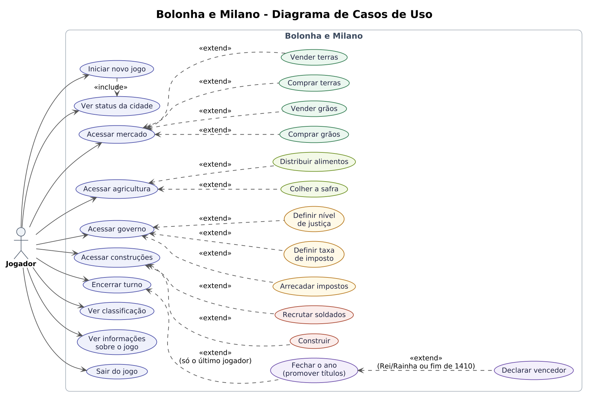
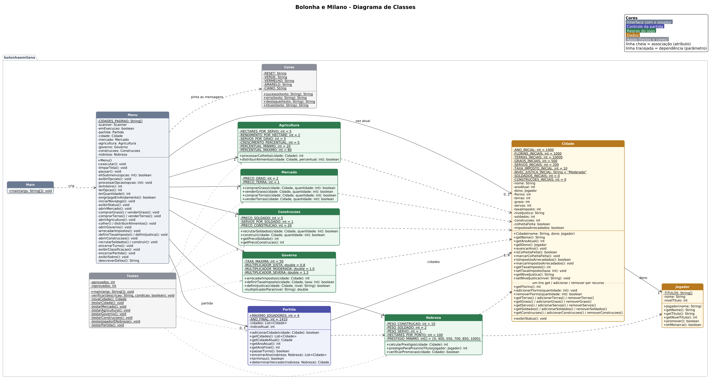
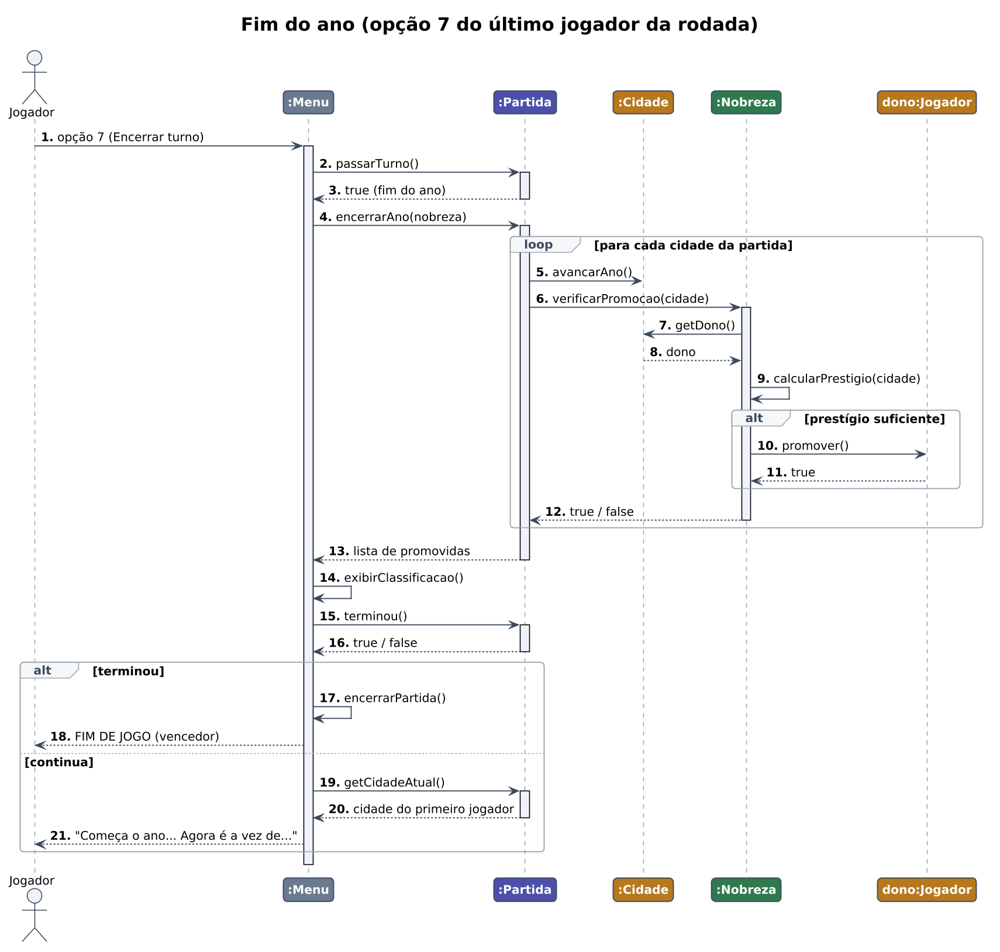

# Bolonha e Milano

Jogo de estratégia econômica na Itália medieval, de 1 a 4 jogadores no mesmo computador,
com interface visual no navegador (e modo clássico no terminal). Cada jogador governa uma
cidade-Estado e tenta subir de título:

**Cavaleiro → Barão (400) → Conde (550) → Marquês (700) → Duque (850) → Rei/Rainha (1000)**

O jogo termina quando alguém vira Rei/Rainha ou ao fim de 1410. Vence o título mais alto
e, no empate, o maior prestígio.

```
prestígio = construções × 10 + soldados × 2 + servos + terras ÷ 100
```

Florins guardados não contam. Só se sobe um título por ano.

Projeto do 4º bimestre de Teoria e Desenvolvimento de Sistemas (SPOTDES), IFSP São Paulo.

## Como compilar e jogar

É preciso ter o Java 17 (JDK). Na pasta raiz do repositório:

```bash
javac -encoding UTF-8 -d bin src/bolonhaemilano/*.java
java -cp bin bolonhaemilano.Main
```

Por padrão, o comando acima inicia a **interface visual** em `http://localhost:8080` e abre
o navegador automaticamente. Opções disponíveis:

- `--port <numero>` — define a porta HTTP (padrão `8080`)
- `--no-browser` — inicia o servidor web sem abrir o navegador automaticamente
- `--cli` ou `--terminal` — executa o jogo no modo clássico de terminal (`Menu`)

## Como rodar os testes

```bash
java -cp bin bolonhaemilano.Testes
java -cp bin bolonhaemilano.TestesWeb
```

Saídas esperadas:
- `Testes`: `Aprovados: 37 | Reprovados: 0` (regras de domínio)
- `TestesWeb`: todos os testes da API HTTP/JSON e arquivos estáticos aprovados (`Reprovados: 0`)

## Melhorias extras

Além do que as 8 etapas pedem:

- **Tela limpa a cada volta do menu** (`limparTela()` no `Menu`): o ano e a vez do
  jogador ficam sempre no topo, e `pausar()` segura cada resultado até o ENTER.
- **Cores no terminal** (classe `Cores`): verde quando a ação deu certo, vermelho
  quando foi recusada, amarelo para o fim do ano, promoções e vencedor.

As cores e a limpeza usam códigos ANSI, que funcionam no Terminal do Windows
(Windows Terminal). Em consoles que não entendem ANSI aparecem símbolos no lugar.

## Menu

| Opção | O que faz |
|---|---|
| 1 | Novo jogo: de 1 a 4 jogadores, com nomes e cidades (Enter aceita a cidade sugerida) |
| 2 | Ver status da cidade da vez |
| 3 | Mercado: comprar e vender grãos (2 florins) e terras (1 florim/ha) |
| 4 | Agricultura: colher (1 vez por ano) e distribuir alimentos (20% a 80%) |
| 5 | Governo: arrecadar impostos (1 vez por ano), taxa (0 a 50%) e justiça |
| 6 | Construções: recrutar soldados (5 florins + 1 servo) e construir (20 florins) |
| 7 | Encerrar turno: passa a vez; o último jogador fecha o ano |
| 8 | Ver classificação: prestígio de cada cidade e meta do próximo título |
| 9 | Sobre o jogo |
| 0 | Sair |

Toda cidade começa em 1400 com 1000 florins, 10000 ha de terras, 500 grãos, 200 servos,
imposto de 10% e justiça Moderada (prestígio 300).

## Organização

```
src/bolonhaemilano/
  Main.java          ponto de entrada: inicia a interface visual (ou Menu com --cli)
  ServidorWeb.java   servidor HTTP embutido (JDK 17) e API JSON sobre as regras do jogo
  Menu.java          laço do modo terminal; lê, chama as regras e mostra
  Partida.java       turnos, anos, fim de jogo e vencedor (1 a 4 cidades)
  Cidade.java        ano, recursos, governo, defesa e o que já foi feito no ano
  Jogador.java       nome e título de nobreza
  Mercado.java       compra e venda
  Agricultura.java   colheita e comida
  Governo.java       impostos e justiça
  Construcoes.java   soldados e obras
  Nobreza.java       prestígio e promoção de títulos
  Testes.java        testes automáticos das regras de domínio (main próprio, sem JUnit)
  TestesWeb.java     testes automáticos do servidor HTTP/JSON e rotas estáticas
  Cores.java         cores das mensagens no terminal (melhoria extra)
web/
  index.html         estrutura da interface visual
  styles.css         estilo pergaminho renascentista responsivo
  app.js             controle da interface, pré-visualizações e panorama SVG dinâmico
uml/
  diagrama-classes.puml / .png
  diagrama-sequencia-fim-do-ano.puml / .png
casos-de-uso/
  diagrama-casos-de-uso.puml / .png
```

## Diagramas

Os diagramas foram escritos em PlantUML (arquivos `.puml`); os `.png` são as imagens geradas a partir deles.

### Casos de uso



### Classes



### Sequência: fim do ano


